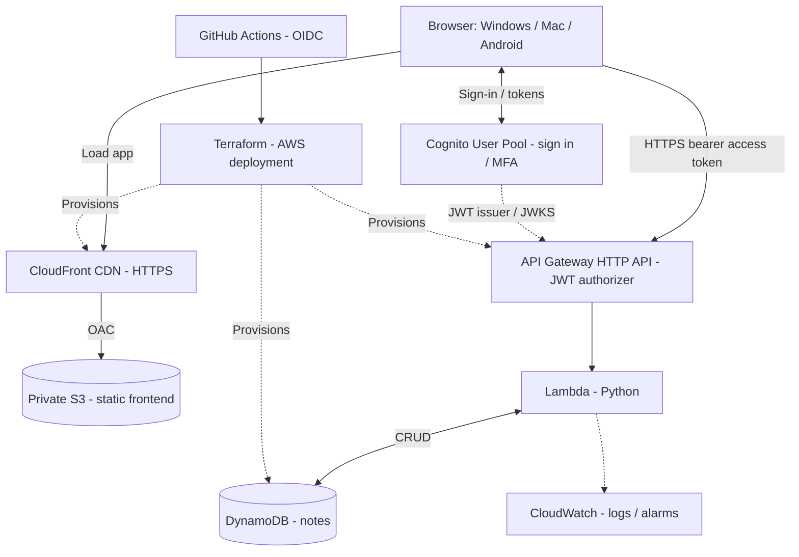

# NoteBox ☁️

A minimal, personal, browser-based message inbox. Built for **low AWS cost and high hands-on Cloud/DevOps learning**.

> Status: **project scaffold only**. No working AWS backend or infrastructure is provisioned yet.

## Goals
- Capture and retrieve short text messages, URLs, and commands from any browser.
- Learn Python, HTTP/JSON, AWS serverless, Terraform, GitHub Actions, IAM, monitoring, and testing.
- Target $0–$1/month for very light use where applicable free allowances cover usage. This is **not guaranteed**.
- Do not store employer-confidential data or passwords.

## Proposed architecture



## Repository map

```text
notebox/
├── .github/workflows/        # Test and deployment workflow placeholders
├── backend/
│   ├── src/                  # Python Lambda business logic (planned)
│   ├── tests/                # Unit tests
│   └── requirements-dev.txt
├── frontend/
│   ├── index.html            # Browser interface placeholder
│   └── src/                  # JavaScript and CSS
├── infra/terraform/
│   ├── environments/dev/     # Root deployment stack (planned)
│   └── modules/              # Reusable AWS resource modules (planned)
├── docs/
│   ├── architecture.md       # Architecture and security notes
│   ├── learning-roadmap.md   # Learning milestones
│   └── api-contract.md       # Future REST interface
├── scripts/                  # Developer helper scripts
├── .gitignore
└── README.md
```

See [GitHub setup](docs/github-setup.md) for initializing the repo or renaming an existing one.

## Roadmap
1. **Local MVP:** Implement a local Python API and a simple browser UI; write unit tests.
2. **AWS backend:** DynamoDB, Lambda, HTTP API, Cognito; confirm authenticated user isolation.
3. **Static hosting:** Private S3 + CloudFront with OAC; HTTPS and correct CORS.
4. **Infrastructure as Code:** Replace manual resources with Terraform; use a safe state strategy.
5. **CI/CD:** Test on pull request; deploy with GitHub Actions OIDC and environment approvals.
6. **Operations:** CloudWatch alarms, AWS Budgets, log retention, backup/restore and rollback drills.

## Cost and security guardrails
- Avoid EC2, NAT Gateway, RDS and EKS.
- Set an AWS Budget with email alerts; budgets do **not** impose a hard cap.
- Pin one AWS region where practical; monitor actual free-tier eligibility.
- Keep S3 bucket private with CloudFront Origin Access Control.
- Reject unauthenticated API requests; use a Cognito JWT authorizer.
- Enforce per-user ownership **inside the Lambda API** using verified token claims.
- Least-privilege execution role; never commit access keys, secrets, state, or `.env` files.
- Use GitHub Actions OIDC, not long-lived AWS keys.
- Keep CloudWatch retention short at first (e.g. 7 days).
- Make backups and test restore before relying on the service for important notes.

## Development status
This is a learning scaffold, **not a finished app**. Files under `infra/terraform/modules` are intentionally empty until the relevant phase.
